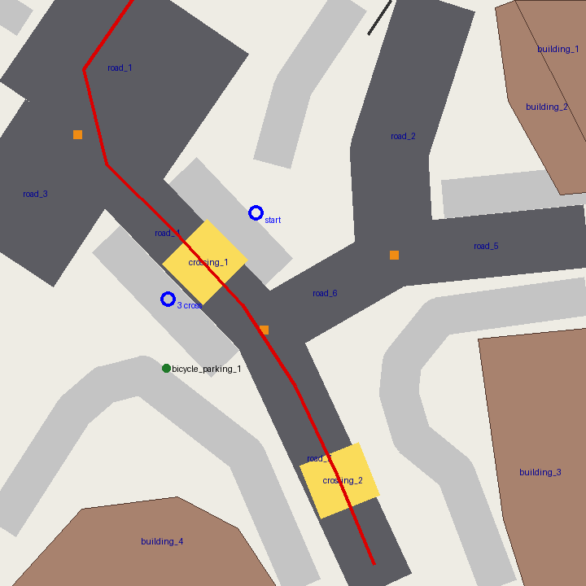

# Synthetic data generation: user prompt, algorithm, one example (27 Nov 2026)

Point notes for the appendix, not paper text. Code: `src/usg/training/{window,records,prompt}.py`, `scripts/window_data.py`, `scripts/window_example.py`.

## 1. User prompt template
`<...>` is filled from the window, `[...]` is optional. A section without entries holds the single line `none`.

```text
# MAP
size: 30 x 30 m
frame: origin at the centre; x grows east, y grows north; metres; x and y in [-15, 15]

## ROADS
<road_N>: <class>, width <m>, lanes <n>, <two-way | one-way, in the listed point order>, speed limit <v> m/s[, passes under a building]
  centre line: (<x>,<y>) ...
  ends: <side> end <leaves the window | at junction_N | continues as road_N | road ends>; ...

## SIDEWALKS
<sidewalk_N>: [<side> of <road_N>, ]width <m>, centre line (<x>,<y>) ...[, passes under a building]

## JUNCTIONS
<junction_N>: at (<x>,<y>), radius <m>, joins <road_N>, ...[, signalised]

## CROSSINGS
<crossing_N>: <zebra | signals | uncontrolled>[, over <road_N>], width <m>, kerb to kerb (<start side>) (<end side>)[, signal <signal_N>]

## SIGNALS
<signal_N>: <vehicle | pedestrian> light at (<x>,<y>)[, for <crossing_N>]

## PATHS
<path_N>: <type>, width <m>, centre line (<x>,<y>) ...[, passes under a building]

## STAIRS
<stairs_N>: area (<x>,<y>) ...

## OBJECTS
<type>: <type_N> (<x>,<y>); ...

## BUILDINGS
<building_N>: outline (<x>,<y>) ...[, courtyard (<x>,<y>) ...]

## AREAS
<area_N>: <type>, outline (<x>,<y>) ...

## BARRIERS
<barrier_N>: <type>, line (<x>,<y>) ...

# REQUEST
<request>
```
The system prompt differs by level only (`example/system_L0.txt`, `example/system_L1.txt`): reply format, allowed calls, fixed defaults.

## 2. Dataset algorithm
```text
for each area (split by area: train, val):
    M = metric map from the OpenStreetMap extract
    for (kind, centre) in select_windows(M, W):                      # 2.1
        window = build(M, centre)                                    # clip, clean, local ids
        local  = localise(M, window, centre)                         # simulator map in window coordinates and ids
        text   = to_text(window)
        repeat up to 8*K times, until K records are kept:
            r = sample_record(window, local)                         # 2.2
            if r is None, or r holds a held-out combination: continue
            q = render_request(r)                                    # 2.3
            if (window, q) already used: continue
            y0, y1 = render_L0(r), render_L1(r)                      # 2.4
            if verify(r, y0) and verify(r, y1):                      # 2.5
                for L in {0, 1}: write (system_L, text + q, y_L)
```

### 2.1 Windows
* Anchors: crossings, junctions, points along long roads, points along pedestrian ways. Quotas: crossing 40%, junction 20%, street 25%, pedestrian 15%.
* Centre = anchor + uniform offset in [-6, 6] m; at least 5% walkable; centres at least 20 m apart.
* Clipping, cleaning and ids: `paper/p1/ALGORITHM.md`.

### 2.2 Record sampling
Record = start, stages, order, vehicles, signal, rules. Branches are tried in this order.

**A. Crossing task** (probability 0.7 if the window has a crossing)
1. Crossing and side: uniform. Start 2 m behind that kerb; start and both sides must lie in the window.
2. Signalised: cycle (green, red) from {(15,20), (12,18), (10,25), (20,15)}, starts red; with 0.7 add `wait_for_green` and rule `obey_signal`.
3. Traffic: none 0.25, moving vehicle 0.5, parked cars 0.25.
   * Moving: car, van, bus or truck on the crossed road; 3-8 m/s; with 0.4 a `look` stage first.
   * Parked: 1-3 cars at the kerb, more than 6 m from the crossing.
4. Stage `cross`. With vehicles: rule `collision_free`, distance 0.3 (probability 0.5), 1.0 or 1.5 m.
5. With 0.2: line rule (start to far side, 2.0 or 2.5 m).
6. With 0.25: after crossing, `reach` (0.7) or `hold` (0.3) a target on the far side.

**B. Road point** (otherwise, with 0.15 if the window has a road): start on a sidewalk or path; target on the carriageway 3-15 m away, straight walk free of buildings, water and barriers; with 0.3 a speed limit.

**C. Visit** (otherwise)
1. Start: random sidewalk or path point.
2. 1-3 stages (drawn 0.4, 0.4, 0.2; fewer if no further target fits); targets are objects or points, at least 4 m from the start and earlier targets, straight walk off road and crossings; `hold` (3, 5, 8 or 10 s) with 0.25.
3. Speed limit (1.5, 1.8, 2.0 m/s) with 0.35; stay on sidewalk with 0.3 if all points are on sidewalks; 1-2 parked cars with collision rule (0.3 or 1.0 m) with 0.2.

**Order:** one stage = `one`; several = `ordered`, or `any` with 0.4 if all stages are visits.

**Held out** (never in train or val): look + speed limit; wait for green + parked cars; line rule + moving vehicle; hold + stay on sidewalk.

### 2.3 Request
* Parts: start; signal cycle; one sentence per vehicle; one task sentence (stages joined by order words); one sentence per rule.
* Each part has 2-5 fixed phrasings, drawn at random; with 0.3 the task sentence comes before the scene description.
* Every phrasing states all values of its part. Radii, look angle and time limits are fixed defaults and are not written.

### 2.4 References
* L0: Python script with helper calls. L1: JSON specification (library formulas) plus world script.
* Walking rules go to every task; vehicle, signal and line rules to the crossing task, or to every task without one.
* Moving vehicle: the reply gives roads, meeting place and speed. The simulator places the car so that it arrives when a walker who does not wait would (1.2 m/s, plus 3 s per look task), extending the route along connected roads beyond the window.

### 2.5 Verifier
1. Gates: the script runs and the simulator validator reports no error (reachability, time limits, placement, rules satisfiable by a reference walker).
2. One check per field: start (1 m), stages, order, vehicles, encounter (5 m along the route, 4 m lateral), signal, rules, time limits.

## 3. Example
Window `zurich_005`. Blue = start and stage goals, red = car route.



### Record
```json
{
 "window": "zurich_005",
 "start": [
  -1.9,
  4.1
 ],
 "stages": [
  {
   "kind": "look",
   "entity": "Car1"
  },
  {
   "kind": "wait_for_green",
   "crossing": "crossing_1",
   "side": "end"
  },
  {
   "kind": "cross",
   "crossing": "crossing_1",
   "side": "end"
  }
 ],
 "order": "ordered",
 "vehicles": [
  {
   "name": "Car1",
   "type": "car",
   "moving": true,
   "roads": [
    "road_4"
   ],
   "meet": "crossing_1",
   "speed": 7
  }
 ],
 "signal": {
  "crossing": "crossing_1",
  "green": 10,
  "red": 25,
  "initial": "red"
 },
 "rules": [
  {
   "kind": "obey_signal",
   "crossing": "crossing_1"
  },
  {
   "kind": "collision_free",
   "entity": "Car1",
   "d": 0.3
  }
 ]
}
```
### User prompt
```text
# MAP
size: 30 x 30 m
frame: origin at the centre; x grows east, y grows north; metres; x and y in [-15, 15]

## ROADS
road_1: tertiary, width 9.8, lanes 3, one-way, in the listed point order, speed limit 13.9 m/s
  centre line: (-6.3,15) (-11,8.1)
  ends: north end leaves the window; south end at junction_1
road_2: service, width 4, lanes 1, one-way, in the listed point order, speed limit 5.5 m/s
  centre line: (7.4,15) (4.9,7.2) (5.2,1.9)
  ends: north end leaves the window; south end at junction_2
road_3: tertiary, width 6.5, lanes 2, one-way, in the listed point order, speed limit 13.9 m/s
  centre line: (-11,8.1) (-15,2.1)
  ends: north end at junction_1; south end leaves the window
road_4: residential, width 3.2, lanes 1, one-way, in the listed point order, speed limit 8.3 m/s
  centre line: (-11,8.1) (-1.5,-1.9)
  ends: north end at junction_1; south end at junction_3
road_5: residential, width 3.2, lanes 1, one-way, in the listed point order, speed limit 8.3 m/s
  centre line: (5.2,1.9) (15,2.9)
  ends: west end at junction_2; east end leaves the window
road_6: residential, width 3.2, lanes 1, two-way, speed limit 8.3 m/s
  centre line: (-1.5,-1.9) (5.2,1.9)
  ends: west end at junction_3; east end at junction_2
road_7: residential, width 3.2, lanes 1, one-way, in the listed point order, speed limit 8.3 m/s
  centre line: (-1.5,-1.9) (4.6,-15)
  ends: north end at junction_3; south end leaves the window

## SIDEWALKS
sidewalk_1: west of road_1, width 2, centre line (-14.1,15) (-15,13.7)
sidewalk_2: west of road_2, width 2, centre line (-1,6.6) (0,10.5) (3,15)
sidewalk_3: north of road_4, width 2, centre line (-5.6,6.3) (-0.7,1.1)
sidewalk_4: north of road_5, width 2, centre line (7.7,4.8) (15,5.6)
sidewalk_5: south of road_4, width 2, centre line (-9.6,2.8) (-3.5,-3.6)
sidewalk_6: south of road_2, width 2, centre line (15,-0.2) (7.5,-1.2) (5.6,-3.5) (5.4,-5.2) (6.1,-7.4) (8.3,-9.2) (10.5,-15)
sidewalk_7: west of road_4, width 2, centre line (-15,-11.9) (-11.2,-6) (-9.6,-4.7) (-7.7,-4.2) (-2.4,-8.3) (0.5,-15)

## JUNCTIONS
junction_1: at (-11,8.1), radius 7.2, joins road_1, road_3, road_4, signalised
junction_2: at (5.2,1.9), radius 5.6, joins road_2, road_5, road_6
junction_3: at (-1.5,-1.9), radius 5.6, joins road_4, road_6, road_7, signalised

## CROSSINGS
crossing_1: signals, over road_4, width 3, kerb to kerb (-5.6,0.4) (-3.4,2.7), signal signal_1
crossing_2: uncontrolled, over road_7, width 3, kerb to kerb (0.9,-10.2) (3.9,-9)

## SIGNALS
none

## PATHS
none

## STAIRS
none

## OBJECTS
bicycle_parking: bicycle_parking_1 (-6.5,-3.9)

## BUILDINGS
building_1: outline (15,15) (11.4,15) (11.9,12.3) (15,7.7)
building_2: outline (15,7.7) (11.4,15) (10.3,14.6) (11,9.8) (13.7,5) (15,5.1)
building_3: outline (15,-15) (15,-1.8) (9.5,-2.4) (10.8,-11.6) (11.9,-15)
building_4: outline (-10.8,-11.1) (-14.4,-15) (-0.8,-15) (-2.8,-12) (-5.9,-10.4)

## AREAS
none

## BARRIERS
barrier_1: retaining_wall, line (3.9,13.2) (5,15)

# REQUEST
The participant starts at (-1.9, 4.1). Tasks, in this order: turn your eyes to Car1; after that stand at the side (-2.6, 3.4) of crossing_1 until its light turns green; after that get across crossing_1, starting from the side at (-2.6, 3.4). crossing_1 has a pedestrian light: 10 s green, 25 s red, red at the start. Car1, a car, comes toward crossing_1 along road_4 with a speed of 7 m/s. Do not step onto crossing_1 unless the signal is green. Do not collide with Car1.
```
### L0 reference
```python
from usg.dsl import *
scenario = ScenarioBuilder("scenario", MAP, scenario_type="custom")
scenario.user(Place(-1.9, 4.1).facing(MAP.place("crossing_1")))
scenario.signal_cycle("crossing_1", green=10, red=25, initial="red")
scenario.approaching_vehicle("Car1", ["road_4"], meet="crossing_1", speed=7, model="car_white")
t1 = scenario.look_at("Car1", "Look at the vehicle.", name="t1_look")
t2 = scenario.wait_for_green("crossing_1", "end", "Wait for green.", name="t2_wait_for_green")
t3 = scenario.cross("crossing_1", "end", "Cross the street.", tolerance=2.0, obey_signal=True, name="t3_cross", keep_clear={"Car1": 0.3})
scenario.sequence([t1, t2, t3])
```

### L1 reference
```json
{"tasks":[{"name":"t1_look","instruction":"Look at the vehicle.","goal":{"op":"call","name":"look","args":{"entity":"Car1","angle":45,"seconds":12}},"timeout":{"initial":60,"baseline":90}},{"name":"t2_wait_for_green","instruction":"Wait for green.","goal":{"op":"call","name":"wait_for_green","args":{"zone":{"kind":"crossing_side","id":"crossing_1","side":"end","inset":1.0,"r":2.0},"signal":"signal_1"}},"timeout":{"initial":60,"baseline":90},"after":["t1_look"]},{"name":"t3_cross","instruction":"Cross the street.","goal":{"op":"call","name":"cross","args":{"far_zone":{"kind":"crossing_side","id":"crossing_1","side":"start","inset":1.0,"r":2.0}}},"safety":[{"op":"call","name":"obey_signal","args":{"zone":{"kind":"crossing","id":"crossing_1"},"signal":"signal_1"}},{"op":"call","name":"collision_free","args":{"entity":"Car1","r":0.3}}],"timeout":{"initial":60,"baseline":90},"after":["t2_wait_for_green"]}]}
```
```python
from usg.dsl import *
scenario = ScenarioBuilder("scenario", MAP, scenario_type="custom")
scenario.user(Place(-1.9, 4.1).facing(MAP.place("crossing_1")))
scenario.signal_cycle("crossing_1", green=10, red=25, initial="red")
scenario.approaching_vehicle("Car1", ["road_4"], meet="crossing_1", speed=7, model="car_white")
handles = scenario.apply_spec(SPEC)
```

### Verifier
* L0: start pass, stages pass, order pass, vehicles pass, encounter pass, signal pass, rules pass, time_limits pass
* L1: start pass, stages pass, order pass, vehicles pass, encounter pass, signal pass, rules pass, time_limits pass

## 4. Probe run (4 areas, 12 windows each, up to 6 records per window)
| item | count |
|---|---|
| records kept (each at L0 and L1) | 284 |
| draws with no possible record in the window | 115 |
| held-out filter (intended) | 26 |
| failed: time limit too short for the route found | 103 |
| failed: target unreachable | 32 |
| failed: no route | 11 |
| failed: a rule violated by the reference walker | 10 |
| failed: vehicle route off road, or road too short | 8 |

* Of 448 records that reached the checks, 284 passed (63%).
* Kinds: single-target visit 85, road point 38, plain crossing 36; waiting for green only 1.
* Prompt plus reply (measured one revision earlier): median 1823 tokens, 95th percentile 2671, maximum 3348.

## 5. Known limits
* The walking graph often finds routes of 60-600 m between points of one window. Valid records are rejected, mostly visits.
* Signalised windows are rare, so signal tasks are nearly absent.
* Vehicles do not obey signals; a car passing while the walker must wait for green is not a real encounter.
* Visibility of a car to be looked at is not checked.
* The verifier has not been tested with deliberately wrong replies; no hand check of samples.
* Wording comes from fixed phrasings (no language-model paraphrase).

## 6. Command
```powershell
.usg_env\Scripts\python.exe scripts\window_data.py --windows 50 --per-window 8 --workers 6
```
